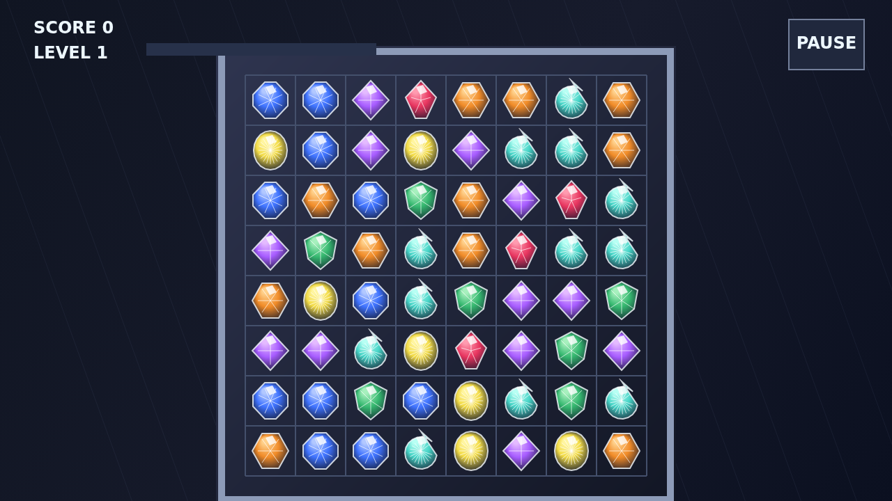

# Facet

Facet is a match puzzle played on a lit bench of cut stones. Take hold of one
gem, carry it onto a neighbor, and release to swap; if the move makes a line of
three or more, the stones shatter and the column falls into motion.

Every clear pushes strain into the gems beside it. Cracks deepen from small
fault lines into flawed stones, and a flawed stone breaks with any clear that
touches it. Those doubled points make worn corners of the board dangerous and
valuable at the same time.

Four in a line leaves a brilliant, five or more leaves a prism, and crossed
matches leave a star. Those cuts are the prizes that turn a tidy match into a
chain: brilliants burst nearby gems, stars sweep whole rows and columns, and
prisms can take every gem of one kind.

Each chain step climbs the multiplier. Reach the level target to keep going;
the round ends only when no scoring swap remains.
